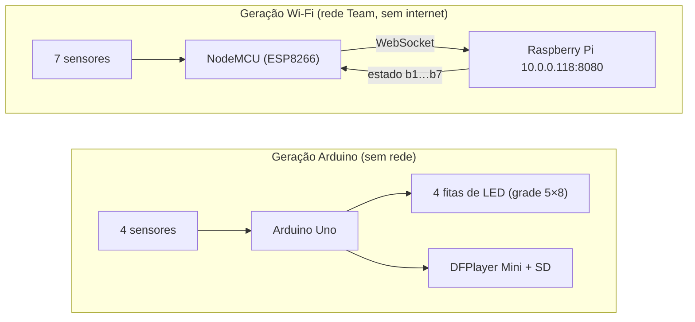

# Flauta Mágica

Documentação e código recuperado do kit **Flauta Mágica**: uma flauta com sensores que dispara sons e luzes. O kit passou
por mais de uma geração de hardware (Arduino Uno; depois NodeMCU/ESP32 conversando por Wi-Fi com um Raspberry Pi).

Este repositório reúne o que foi possível **recuperar e reconstruir**, junto com as simulações que permitem ver a lógica
funcionando no computador.

## Por que existe código "reconstruído"

Os códigos-fonte dos firmwares (Arduino, NodeMCU, ESP32) **não foram obtidos**. O que havia nas placas era o programa já
compilado, e o texto original (nomes, comentários) não existe nelas. A lógica foi recuperada lendo as placas e desmontando
os binários. O único código-fonte em texto que se conseguiu foi o do servidor do Raspberry Pi (ver [Origem e créditos](#origem-e-créditos)).

## Visão geral

Detalhes, protocolo e pontos em aberto em [`docs/arquitetura.md`](docs/arquitetura.md).

## Estrutura

| Pasta | O que é |
|---|---|
| [`arduino-uno/`](arduino-uno/) | Firmware da flauta no Arduino (DFPlayer, 4 fitas de LED, 4 sensores): leitura bruta, análise, reconstrução em C++ e simulações em Java e JavaScript |
| [`arduino-teste-imu-mpu9250/`](arduino-teste-imu-mpu9250/) | Outro firmware lido de uma placa Arduino: teste de um sensor inercial MPU9250 (não é da flauta) |
| [`nodemcu-esp8266/`](nodemcu-esp8266/) | NodeMCU: cliente WebSocket que envia o estado de 7 sensores (só análise; sem código-fonte) |
| [`esp32/`](esp32/) | ESP32: cliente WebSocket (só análise; sem código-fonte; papel a confirmar) |
| [`raspberry-pi/`](raspberry-pi/) | Servidor WebSocket em Node.js que roda no Raspberry Pi |
| [`flauta-virtual-processing/`](flauta-virtual-processing/) | Flauta Virtual: programa em Processing com 7 botões que tocam sons |
| [`docs/`](docs/) | Arquitetura, registro das leituras das placas e rascunhos |

## Código original × reconstrução

| Item | Natureza |
|---|---|
| `arduino-uno/firmware-original/Copia.ino.hex` | **Exato**: leitura bruta da flash da placa |
| `arduino-uno/reconstrucao-cpp/` | **Reconstrução** em C++ (ainda não compilado) |
| `arduino-uno/simulacao-java/`, `simulacao-javascript/` | **Reconstrução** da mesma lógica, para rodar no computador |
| `raspberry-pi/servidor-websocket/` | Código em texto, copiado como estava (de terceiros) |
| `nodemcu-esp8266/`, `esp32/` | Apenas análise; os dumps brutos não são publicados |

Nas reconstruções, vêm **do binário**: pinos, tabelas, cores, tempos, ordem das animações e combinações de sensores.
São **escritos na reconstrução**: nomes de variáveis e funções e comentários. É **suposição**: qual `.wav` corresponde a cada
faixa do cartão SD.

## Como usar

| Parte | Como |
|---|---|
| C++ do Arduino | Abrir o `.ino` no Arduino IDE (bibliotecas: Adafruit NeoPixel e DFRobotDFPlayerMini) |
| Simulação em Java | Abrir o `.pde` no Processing 4 (biblioteca Sound); sons em `arduino-uno/data/` |
| Simulação em JavaScript | Abrir `arduino-uno/simulacao-javascript/index.html` no Chrome ou Edge e clicar em "Iniciar" |
| Servidor do Pi | `cd raspberry-pi/servidor-websocket/versao-cartao-sd && npm install && node index.js` |

Os sons (`.wav`) **não estão no repositório**; cada pasta que precisa deles tem um `LEIA-ME.md` com a lista.

> **Aviso:** não grave nenhum sketch nas placas originais. Cada upload sobrescreve a flash e destrói o que ela guarda.

## Origem e créditos

- **Servidor WebSocket (`raspberry-pi/`)** e **sons**: vêm do GitHub de **Christy386**. A versão só com WebSocket foi obtida
  de lá por quem organizou este repositório, e o cartão SD do Raspberry Pi tinha um clone do repositório de sons
  (`musicasFlautaMagica`) dessa mesma conta. A autoria original deve ser confirmada; **este repositório não reivindica a autoria
  desse código**.
- **Firmwares das placas:** a autoria **não foi confirmada**. Há indícios que apontam para a mesma pessoa (mensagens em
  português em comum entre Arduino e NodeMCU, e o servidor), mas isso não é prova.
- **Bibliotecas de terceiros:** TinyWebsockets (`gilmaimon`, WebSocket nos ESP), Adafruit NeoPixel, DFRobotDFPlayerMini,
  e a biblioteca MPU9250 da Bolder Flight Systems (firmware de teste de IMU).

## Licença

**Não definida.** O servidor e os sons são de terceiros e o repositório de origem pode ter (ou não) uma licença. Antes de
publicar, confirme a licença do repositório de origem ou peça autorização, e então escolha a licença deste repositório.

## Em aberto

- Compilar o `.ino` reconstruído e comparar o tamanho com o dump original (~16 KB).
- Papel do ESP32 no kit.
- Texto exato que o NodeMCU envia ao servidor (ver `docs/arquitetura.md`).
- Se os 7 botões da Flauta Virtual correspondem aos 7 sensores do NodeMCU.
- Cópia completa do cartão SD do Raspberry Pi (a atual tem 12,6%).
