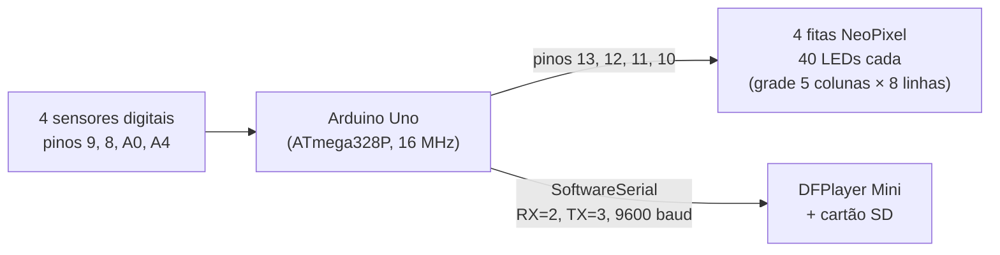
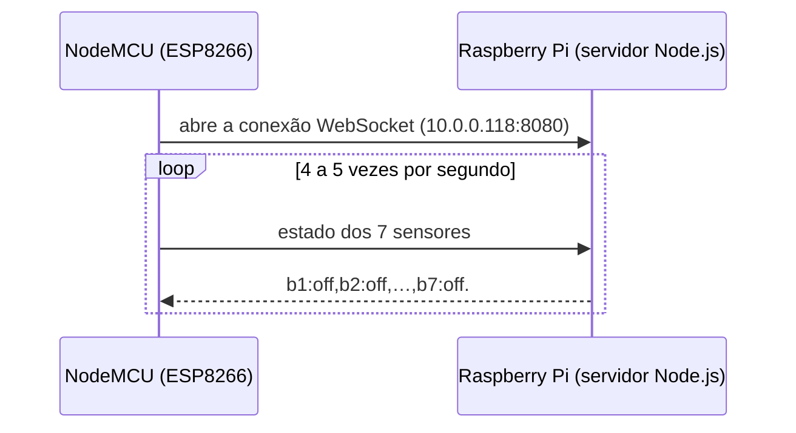

# Arquitetura

Cada afirmação abaixo está marcada como **confirmada** (testada ou lida diretamente), **inferida** (deduzida de indícios)
ou **em aberto**.

## 1. Geração Arduino (sem rede) — confirmada

O firmware do Arduino Uno lê 4 sensores digitais e, conforme a combinação, toca uma faixa no DFPlayer e anima as 4 fitas de LED.

| S1 S2 S3 S4 | Ação |
|---|---|
| 1 0 0 0 | família melódica (som + animação, 3 repetições) |
| 0 1 0 0 | família harmônica |
| 0 0 1 0 | família rítmica |
| 1 0 0 1 | parar o som e apagar as luzes |
| 1 1 1 1 | próximo banco de sons (0 a 5, depois volta a 0) |
| 0 1 1 1 | "volume +": só altera uma variável, não chega ao DFPlayer |

Faixas do cartão SD: melódica `1,2,3,4,5,0` · harmônica `6,7,8,9,10,0` · rítmica `12,13,14,15,16,0`.
Código: [`../arduino/`](../arduino/).

## 2. Geração Wi-Fi (NodeMCU + Raspberry Pi)

### Rede — confirmada
- Roteador `10.0.0.1`, rede `Team`, **sem internet**.
- Raspberry Pi em `10.0.0.118`, com SSH (porta 22) e um servidor WebSocket (porta 8080).

### Fluxo — confirmada

O NodeMCU tem também um DFPlayer Mini com cartão SD ligado.
Código do servidor: [`../raspberry-pi/`](../raspberry-pi/). Análise do firmware: [`nodemcu-e-esp32.md`](nodemcu-e-esp32.md).

### Como o servidor trata as mensagens — confirmada (lida no código)
- Separa o texto por `,` e depois cada parte por `:`, e guarda o resultado em `b1`…`b7`.
- Responde ao cliente com o estado atual, terminado por ponto.
- A condição `if(message.utf8Data = 'update')` usa `=` (atribuição) e é sempre verdadeira, então a resposta sai a **toda** mensagem.
- Não repassa o estado a outros clientes. Um cliente de escuta ligado ao Pi não recebeu os dados da flauta.

A versão do servidor que está no cartão SD também tenta se conectar por `socket.io` a um servidor externo (Replit). Sem
internet, essa conexão não funciona.

### Cartão SD do Raspberry Pi — confirmada
Foi feita uma cópia bruta do cartão (somente leitura), mas ela está **incompleta**: 2,0 GB dos 15,85 GB (12,6%). Da cópia foram
extraídas as pastas do usuário, e delas veio o código do servidor. O cartão também tinha um clone do repositório de sons
(`musicasFlautaMagica`) da conta Christy386 no GitHub, que não foi copiado para este repositório.

## 3. Outras peças

| Peça | O que se sabe | Estado |
|---|---|---|
| ESP32 | Cliente WebSocket para `10.0.0.118`, compilado com PlatformIO; sem strings de DFPlayer | Papel **em aberto** |
| Flauta Virtual (Processing), que fica em outro repositório | 7 botões circulares que tocam 14 sons | Ligação com os 7 sensores **inferida**, não confirmada |

## 4. Parentesco entre as gerações — inferido

As mensagens `Fim da funcao setup` e `DFPlayer Mini online.` aparecem no firmware do Arduino **e** no do NodeMCU, o que
sugere que os programas têm a mesma origem. A ordem cronológica entre as gerações **não foi confirmada**.

## 5. Pontos em aberto

1. **Texto exato enviado pelo NodeMCU.** O servidor espera pares `bN:valor`. Se o NodeMCU enviasse apenas `off,off,…` (sem o
   prefixo `bN:`), o servidor guardaria o valor `undefined`. É preciso capturar uma mensagem real para confirmar.
2. **Papel do ESP32.**
3. **Ligação** entre os sensores do NodeMCU e os botões da Flauta Virtual.
4. **Quem consome o estado** guardado no servidor (a tela ou o aplicativo que usaria os 7 valores), já que o servidor não o repassa.
